# Site Guard

A counter-drone defence game and command-and-control simulator. You place and network sensors and weapons around a power station on a fixed $15M budget, then watch a fusion node detect, track and engage inbound drones using SAPIENT (BSI Flex 335 v2.0) messages. The heart of it is the gap between where drones really are and where your system believes they are.

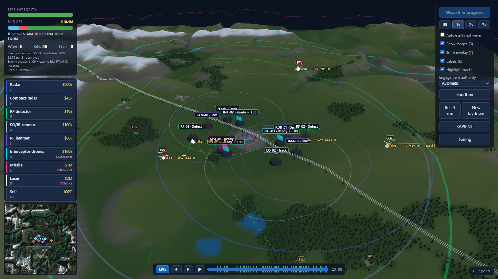

## Tech stack

| Layer | Technology | What it does here |
|---|---|---|
| Simulation | JavaScript (ES modules), no dependencies | Game rules, sensor models, Kalman filter tracking and SAPIENT messages. Runs in the browser or in Node |
| 3D view | [Three.js](https://threejs.org) 0.160 | Terrain, systems, drones, tracks and range rings |
| Interface | [React](https://react.dev) 19 | HUD, toolbar and the SAPIENT dock, with canvas diagrams inside it |
| Build | [Vite](https://vite.dev) 8 | Development server and production bundle |
| Backend | Python 3.12+, [FastAPI](https://fastapi.tiangolo.com), Pydantic, Uvicorn | Stores saved data, validates it and serves the built game |
| Database | SQLite, through Python's `sqlite3` | One local file, with JSON columns for game data |
| Tests | [Vitest](https://vitest.dev), Testing Library, jsdom, pytest, pytest-cov, HTTPX | Simulation, UI and API tests, plus reference runs that pin down behaviour |
| Tooling | npm, [uv](https://docs.astral.sh/uv/) | Pinned dependencies, with lockfiles for both |

## Run it

You need [Node.js](https://nodejs.org) 22.12 or later and [uv](https://docs.astral.sh/uv/). uv installs a suitable Python by itself. Run these from the project folder:

```bash
npm --prefix frontend ci
```

```bash
npm --prefix frontend run build
```

```bash
uv --directory backend run --no-dev python -m app
```

Then open <http://localhost:8200>. The first two commands are only needed once, or again after changing the frontend.

It runs entirely on your machine, works offline, and is only reachable from this computer.

## How it works

Screenshots use scenario seed 7 and terrain seed 3 (`?seed=7&terrain=3`) with the mixed laydown from [`scenarios.js`](frontend/tests/support/scenarios.js).

New to it? Press **Guide me through it** on the start screen. The wizard walks you from an empty site to the first wave: mark the area you are defending, place sensors and effectors, network them, check coverage, rehearse in the sandbox, adjust the figures if you want to, then commit. It works out where you are from the game itself, so you can skip around or close it at any time, and **Open the wizard** brings it back. Drag it by its header if it is in the way. Once a run starts it steps back, with no tips during a wave. When the site falls, a debrief shows what got through and can replay the first leak.

The area you mark is a planning aid. It scores your coverage and saves with the laydown, but drones still aim for the station and for loud emitters, and it cannot change a run.

### 1. Build a laydown

Press **Deploy**, pick a system from the left (or press 1 to 8), and click the ground to place it. Everything comes out of one budget, including every shot fired, and nothing is earned back. No single system handles every drone.

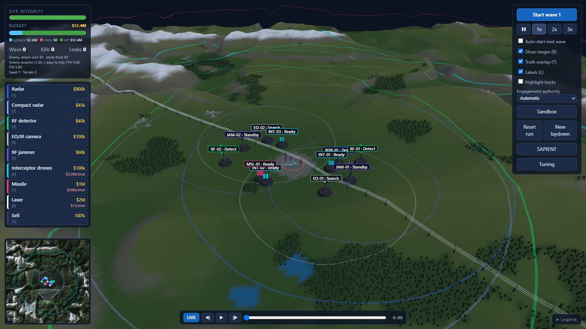

| Key | System | Cost | Per shot | Notes |
|---|---|---|---|---|
| 1 | Radar | $900k | | Range, bearing and velocity. Low flyers hide in ground clutter until close |
| 2 | Compact radar | $45k | | Cheap and short range |
| 3 | RF detector | $40k | | Passive direction finding with no range. Cannot see RF-silent drones |
| 4 | EO/IR camera | $100k | | Narrow view cued by other sensors, with strong classification |
| 5 | RF jammer | $60k | | On only while tracks are in range. Fibre-optic drones ignore it |
| 6 | Interceptor drones | $100k | $5,000 | Good against FPV and fibre-optic strikes. Cannot catch fixed-wing drones |
| 7 | Missile | $1M | $200,000 | Can hit fixed-wing drones |
| 8 | Laser | $2M | $13 | Needs dwell time, so evasive targets take longer |

The attack is made of FPV strike drones ($400), fibre-optic strike drones that fly low and emit no radio ($1,000), fixed-wing strike drones ($35,000) and fixed-wing spotters that make strikes hit harder ($100,000). They get harder to hit and jam each wave.

### 2. Network it

Every system is a SAPIENT node, and an unwired one can't report or be tasked. Open **SAPIENT > Network > Auto-wire**, or wire each one to Starlink or cellular by hand. Links depend on the sky, the terrain, cell towers and your own jammers. Click a system or a wire to see its link and the packets on it, or step through the simulation one packet at a time.

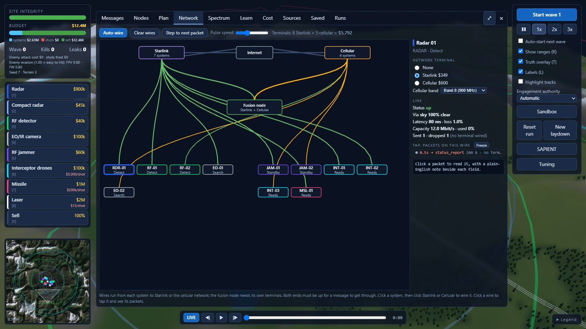

### 3. Check what it can see

The **Plan** tab maps sensor coverage for a chosen drone. Here, this laydown sees very little of a fibre-optic drone at 18 m, while a spotter at 450 m shows almost entirely covered. **Spectrum** shows where your jamming overlaps your own links.

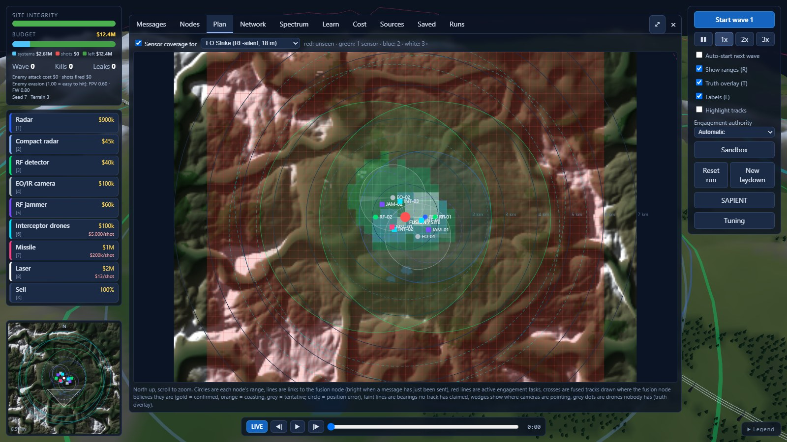

### 4. Rehearse in the sandbox

The **Sandbox** launches any wave's attack, or a custom one, without risk: the site can't be damaged and shots are free. You can still adjust the laydown. Leaving it resets the run and keeps your systems.

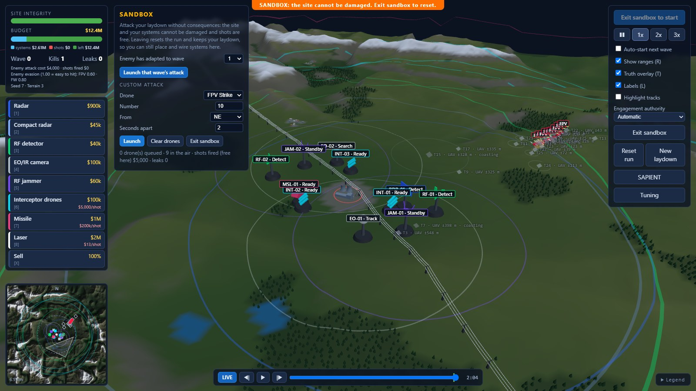

### 5. Fight the waves

Press **Start wave**. The laydown locks at this point and the fusion node takes over: it builds tracks from noisy detections, cues cameras and tasks effectors. **Engagement authority** decides whether it fires by itself, or asks you first for costly shots or for every engagement.

With **Truth overlay** on, as in the screenshot at the top, a tag like `FPV` marks where a drone really is, and a marker like `T88 · UAV ±52 m` marks where the fusion node believes it is. Tracks can lag, get confused or turn out to be ghosts, and effectors only hit a real drone they find at the cued position.

### 6. Read the messages

The **Messages** tab shows every SAPIENT message between nodes, filterable by node. Tick **Explain** for a plain-English note beside each field, or use **Inject fault** to see how errors are reported. **Learn** walks through the protocol using messages from your own run.

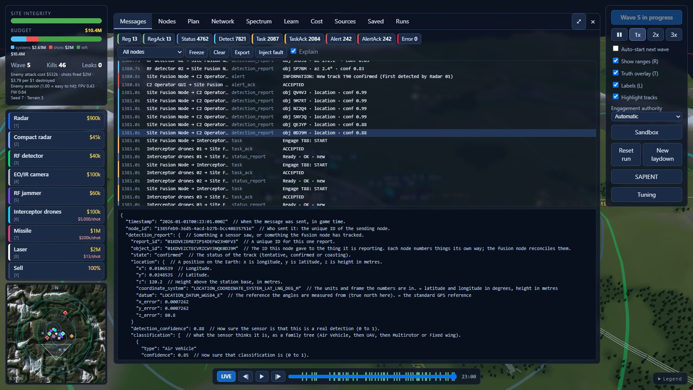

### 7. Rewind and review

Pause at any moment and scrub back through the run. Markers on the timeline show kills, leaks and other events, and a banner shows the state at that moment.

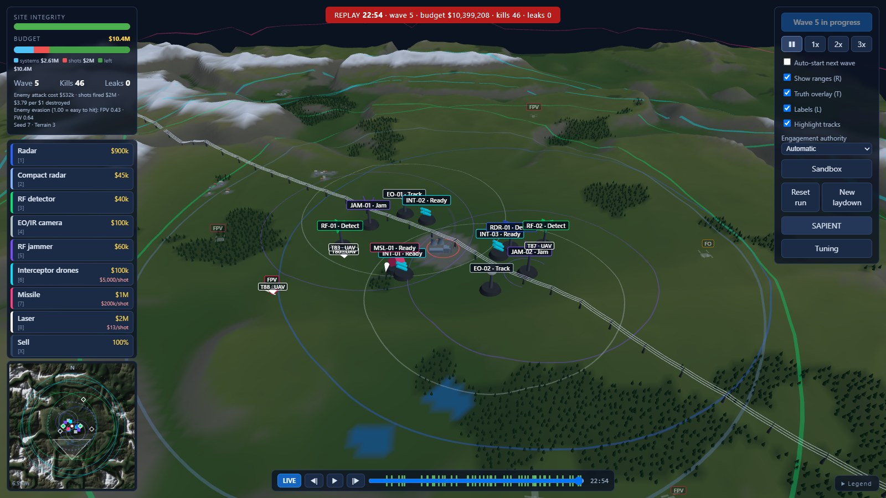

### 8. Count the cost

The **Cost** tab compares what you spent with what the attack cost the enemy, broken down by system, effector and drone type.

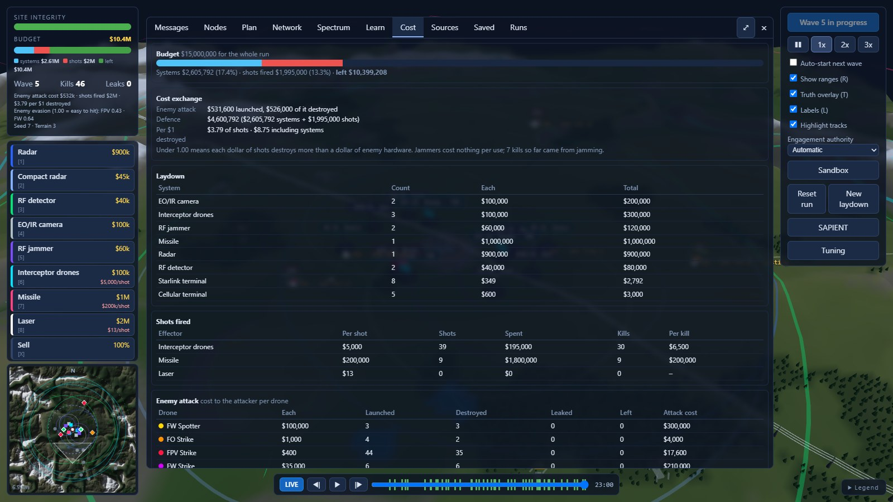

When the site falls, the run is saved to your history in the **Runs** tab. You can retry the same laydown or start a new one, and laydowns are kept in the **Saved** tab.

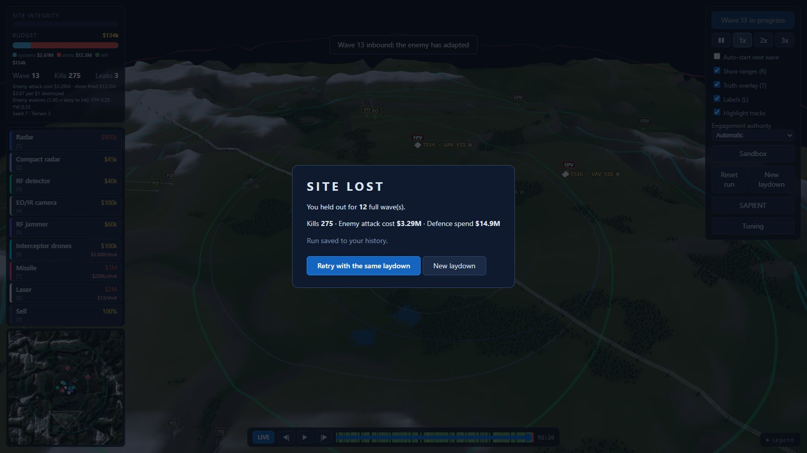

### 9. Question the numbers

The **Sources** tab shows the evidence and confidence behind each figure, and every figure can be edited. Changes take effect at once and can be saved as a named set, exported or imported. See [Accuracy](#accuracy).

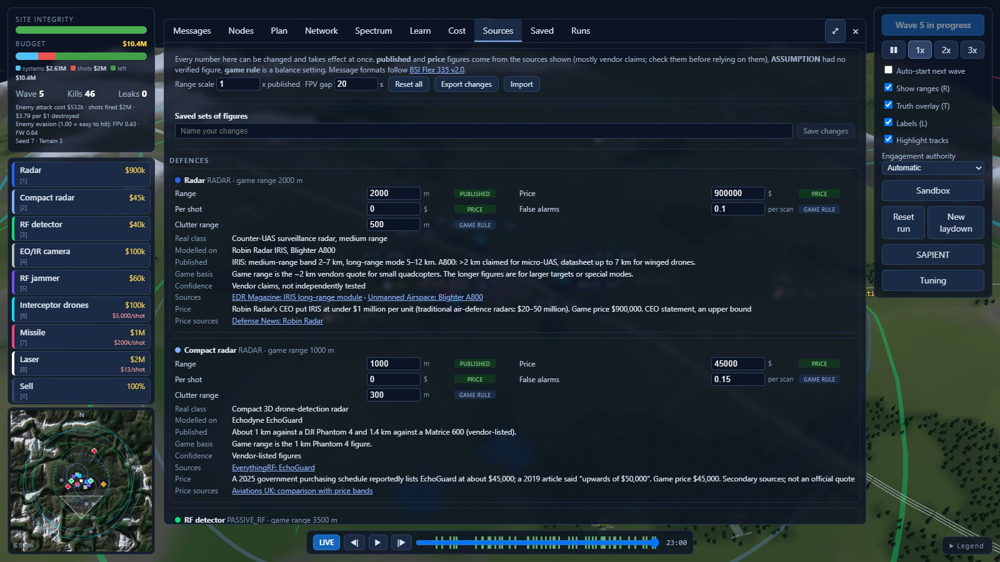

### Controls

| Keys | |
|---|---|
| 1 to 8, X, Esc | Choose a system, sell, cancel |
| Space | Pause, or play and pause a replay |
| Left, Right | Step back and forward through the timeline |
| R, T, L | Ranges, truth overlay, labels |

Drag the wizard, the Sandbox panel or an approval card out of the way. Double-click to put it back.

The same scenario seed, terrain seed and laydown give the same run. Time between later waves is part of what you did, so it changes the run's noise but not the attack.

## Architecture

The simulation runs in the browser, and the backend only stores and serves. It takes no part in live play, so the game still plays if the backend stops. [ADR 0001](docs/adr/0001-simulation-runs-in-the-browser.md) explains why.

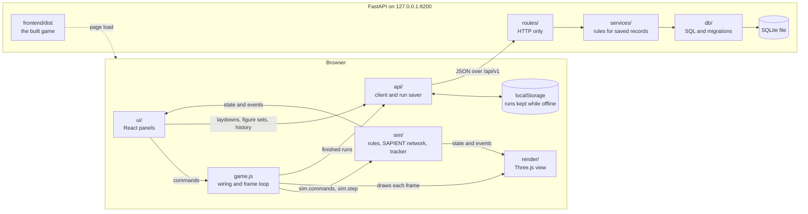

Three rules hold this together:

- **`sim/` has no DOM and no rendering,** so a full game runs in Node for tests and balance work. A test enforces the boundaries.
- **The view and panels only read simulation state.** Everything that changes the game goes through `sim.commands`, which logs it by simulation step, so a saved run can be reproduced exactly.
- **The simulation moves in fixed steps** of 0.05 game seconds, so results don't depend on frame rate or game speed. Panels refresh about 10 times a second, and the recorder keeps a snapshot every half game second for rewinding.

### Inside the SAPIENT network

The fusion node never gets told which drone a detection came from. It associates noisy measurements with Kalman filter tracks, so it can make mistakes. Messages are shaped like the proto3 JSON form of the official BSI Flex 335 v2.0 files, and each one is delayed or dropped by the communications model on its way.

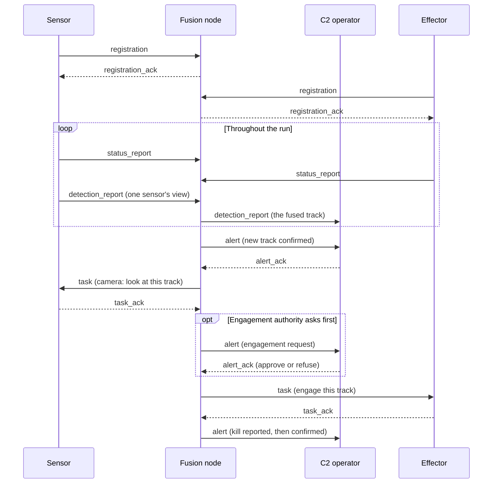

### Where things live

```text
frontend/src/
  sim/        The rules. No DOM, no rendering, so a full game runs in Node.
    config/   Every figure, with its evidence.
    network/  SAPIENT nodes: sensors, fusion, tasking and engagement authority.
    tracker.js  Kalman filter tracks, association and triangulation.
    comms.js    Starlink, cellular and jamming: each message's delay or drop.
    sapient.js  Message envelope, validation and the message bus.
  render/     Three.js. Reads simulation state each frame, and never changes it.
  ui/         React panels, refreshed about 10 times a second.
    assistant/  The wizard: its steps, and what it reads from the game.
  zone.js     The area to defend. Stays out of the simulation.
  api/        The backend client, and keeping runs safe when it is down.
  game.js     Wires the simulation to the view and runs the frame loop.
backend/app/
  routes/     HTTP only.
  services/   The rules for saved records, behind small Protocols.
  db/         All the SQL, and numbered migrations.
  schemas.py  What the API accepts: the trust boundary.
  security.py What protects a local service with no sign-in.
```

### API

Everything is under `/api/v1`, with the schema at `/api/v1/openapi.json`.

| Resource | Routes |
|---|---|
| `/health` | `GET` |
| `/laydowns` | `GET`, `POST`, and `GET`, `PUT`, `DELETE` by ID |
| `/runs` | `GET`, `POST`, and `GET`, `DELETE` by ID |
| `/figure-sets` | `GET`, `POST`, and `GET`, `DELETE` by ID |

There is no sign-in, so the service binds to this machine only, and refuses other hosts and cross-site writes. See the [security notes](docs/SECURITY_NOTES.md), which also say what would be needed before hosting it.

## Saved data

Laydowns, run history and figure sets are in `backend/data/siteguard.db`, a single SQLite file that git ignores. To back it up or move it, copy that file while the game is closed. Set `SITE_GUARD_DB` to keep it somewhere else.

The game still plays if the save server is not running. Panels say so, and a finished run is kept in the browser and saved when the server returns.

## Developing

Run these in two terminals. The game is at <http://localhost:5199>, reloads as you edit, and sends saves through to the backend:

```bash
uv --directory backend run --no-dev python -m app
```

```bash
npm --prefix frontend run dev
```

| Task | Command |
|---|---|
| Frontend tests | `npm --prefix frontend test` |
| Frontend coverage | `npm --prefix frontend run coverage` |
| Backend tests and coverage | `uv --directory backend run pytest` |
| How far each laydown gets | `npm --prefix frontend run balance` |

### Changing behaviour on purpose

Five reference runs in `frontend/tests/support/` pin down the simulation's behaviour exactly. If a change is meant to alter results, re-record them and say why in the commit:

```bash
cd frontend
node tests/support/print-digests.js > tests/support/reference-digests.json
```

Raise `GAME_VERSION` in `frontend/src/sim/config/world.js` at the same time, so old saves warn that they may not play the same. If a saved record changes shape, also run `node tests/support/write-fixtures.js`, because both test suites check those files. A database change needs a new numbered file in `backend/app/db/migrations/`.

### More

- [To do](docs/TODO.md)
- [Implementation plan](docs/MASTER_IMPLEMENTATION_PLAN.md)
- [Development story](docs/DEVELOPMENT_STORY.md)
- [Security notes](docs/SECURITY_NOTES.md)
- [Decision records](docs/adr/)

## Accuracy

The figures are drawn from public sources, mostly vendor claims and press reports, and many are labelled assumptions. The **Sources** tab shows the evidence and confidence for each one, and lets you change it. This is a game and a teaching tool, not a model to base real decisions on.
